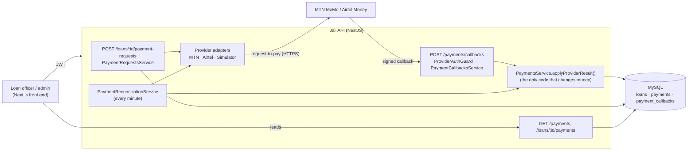
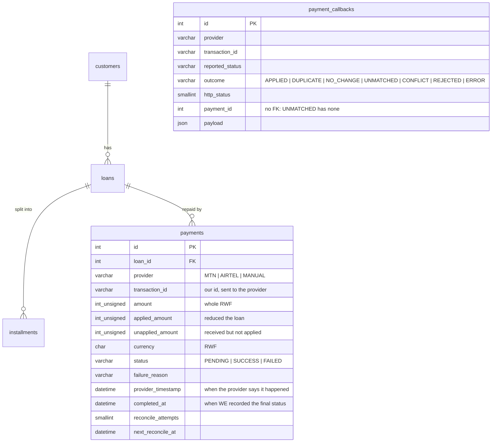
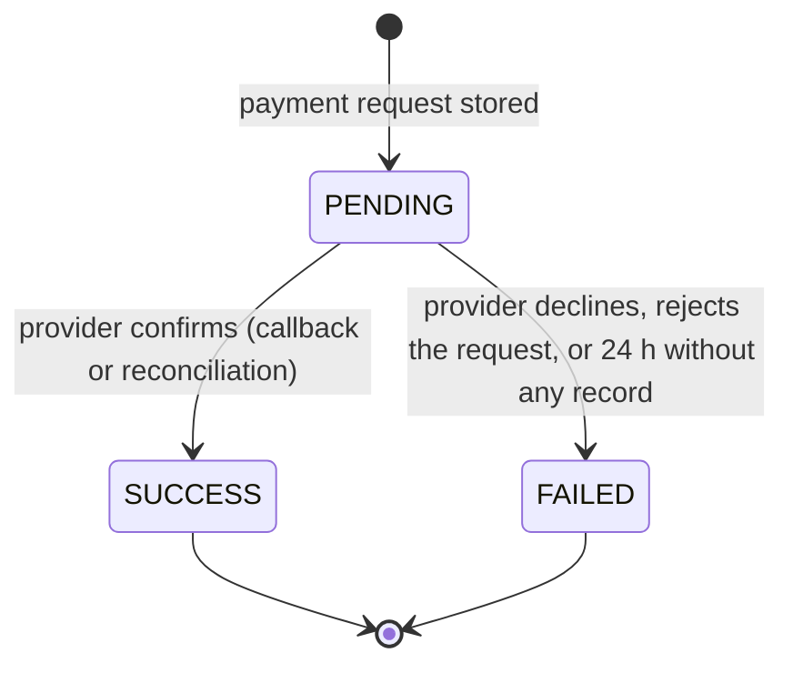

# Payment processing: architecture

How a repayment travels from "please pay" to a reduced loan balance, and why it can't be applied twice, lost, or half-applied.

- [1. System context](#1-system-context)
- [2. Data model](#2-data-model)
- [3. Data flow](#3-data-flow)
- [4. Callback processing in detail](#4-callback-processing-in-detail)
- [5. Reliability cases](#5-reliability-cases)
- [6. Provider integration](#6-provider-integration)
- [7. Failed requests and retries](#7-failed-requests-and-retries)
- [8. Reading payments from Next.js](#8-reading-payments-from-nextjs)
- [9. Security model](#9-security-model)
- [10. Trade-offs and what is not built](#10-trade-offs-and-what-is-not-built)

## 1. System context



Everything that changes a loan balance goes through one method, `PaymentsService.applyProviderResult()`, whether it was triggered by a callback or by the reconciliation job. That is what makes the rules below hold everywhere. (The officer-recorded `POST /loans/:id/repayments` is the one other writer. It uses the same loan lock, and its rows have provider `MANUAL`.)

## 2. Data model



The schema is in [`src/database/migrations/`](../src/database/migrations) (generated from the entities, then checked: `migration:generate --check` reports no drift). Rules the **database** enforces, independent of application code:

| Guarantee | Mechanism |
|---|---|
| A provider transaction is stored once | `UNIQUE (provider, transaction_id)` on `payments` |
| One active loan per customer | `UNIQUE` on the stored generated column `loans.active_customer_id` |
| A payment can't outlive its loan | `FOREIGN KEY ... ON DELETE RESTRICT`. Payments are never deleted. |
| Amounts are exact | `INT UNSIGNED` whole RWF. No floats, and no `DECIMAL`/`BIGINT`, which mysql2 returns as strings. |

**Status lifecycle.** The only legal moves are `PENDING → SUCCESS` and `PENDING → FAILED`. Both are final, so a final payment is never changed again.



## 3. Data flow

### 3.1 Request a payment (staff → API → provider)

```mermaid
sequenceDiagram
    participant FE as Next.js
    participant API as Jali API
    participant DB as MySQL
    participant P as MTN / Airtel
    FE->>API: POST /loans/42/payment-requests {provider, amount}
    API->>DB: BEGIN; lock loan; check active and amount ≤ outstanding − pending
    API->>DB: INSERT payment (PENDING, transaction_id = UUID); COMMIT
    Note over API,DB: Committed BEFORE calling the provider, so any callback,<br/>however late, finds its row.
    API->>P: request-to-pay (X-Reference-Id = transaction_id), 10 s timeout
    alt accepted
        P-->>API: 202
        API-->>FE: 202 {status: PENDING, providerResponse: ACCEPTED}
    else refused (4xx)
        P-->>API: 400 PAYER_NOT_FOUND
        API->>DB: UPDATE ... SET FAILED WHERE status = PENDING
        API-->>FE: 502
    else timeout / 5xx / network error
        API-->>FE: 202 {status: PENDING, providerResponse: UNKNOWN}
    end
```

No lock is held across the network call. The loan balance does **not** change here.

### 3.2 Settle (provider → API)

```mermaid
sequenceDiagram
    participant U as Customer phone
    participant P as MTN / Airtel
    participant API as Jali API
    participant DB as MySQL
    U->>P: approves the prompt
    P->>API: POST /payments/callbacks (token + X-Timestamp + X-Signature)
    API->>API: authenticate → validate → applyProviderResult()
    API->>DB: BEGIN; lock loan; lock payment
    API->>DB: payment → SUCCESS; loan.outstanding −= applied; COMMIT
    API->>DB: INSERT payment_callbacks (audit row)
    API-->>P: 200 {paymentStatus: SUCCESS, duplicate: false}
```

### 3.3 If the callback never arrives

`PaymentReconciliationService` asks the provider (`GET .../requesttopay/{id}`) about `PENDING` payments that are due, and feeds the answer into the same `applyProviderResult()`. See [section 7](#7-failed-requests-and-retries).

## 4. Callback processing in detail

`POST /api/payments/callbacks` (Swagger: *provider callbacks*). Each step can end the request:

| # | Step | Failure → response |
|---|---|---|
| 1 | `ProviderAuthGuard`: bearer token, `X-Timestamp` within ±5 min, HMAC signature (see [section 9](#9-security-model)) | `401` (one generic message) |
| 2 | `ValidationPipe`: DTO `ProviderCallbackDto` | `400` |
| 3 | Find the payment by `(provider, transaction_id)` | `404`, logged as `UNMATCHED` |
| 4 | **Transaction:** lock loan row, then payment row | |
| 5 | Amount or currency differs from what we requested | `422`, left `PENDING` for review |
| 6 | Already final: same status → `200 duplicate: true`. Different status → `409` | |
| 7 | `PENDING` reported: nothing changes | `200` |
| 8 | `FAILED`: record reason. **The loan is not touched.** | `200` |
| 9 | `SUCCESS`: `applied = min(amount, outstanding)`, reduce `outstanding`, close the loan at 0, store any surplus in `unapplied_amount`. Commit. | `200` |
| 10 | Write `payment_callbacks` (after the transaction, best effort) | |

The HTTP status follows the standard retry contract for payment providers: **2xx** = stop retrying, **4xx** = this will never succeed, **5xx** = try again later. Any exception inside the transaction (a lost database connection, say) rolls everything back and returns `500`, so the provider retries and nothing is half-applied.

**Why the locks are taken in this order.** `loan → payment` is the same order the officer-recorded repayment path uses. A consistent lock order is what prevents deadlock cycles. The loan lock is also what serializes two payments on the same loan: the second one waits, then sees the already-reduced balance.

**Why `unapplied_amount` exists.** The provider has *already collected* the customer's money by the time it calls back. If a race means the loan was cleared a moment earlier (an officer recorded a cash payment, say), refusing the callback would not undo that. So the payment is recorded as `SUCCESS` with the surplus kept in `unapplied_amount` and a warning logged, and finance refunds it. Money is never lost silently.

## 5. Reliability cases

Each case below has an automated test in [`test/jali/payment-callbacks.e2e-spec.ts`](../test/jali/payment-callbacks.e2e-spec.ts) or [`payment-requests.e2e-spec.ts`](../test/jali/payment-requests.e2e-spec.ts), run against real MySQL.

| Case | What happens | Why it is safe |
|---|---|---|
| **C1. Same callback three times** (also three *at the same instant*) | The first call applies it (`duplicate: false`). The others return `200 duplicate: true`. The loan balance changes once. | The payment row is locked, and its status is re-read inside the transaction. The unique index is the backstop. Each delivery is still audited. |
| **C2. Provider confirms, but our DB update fails** | The transaction rolls back, so the payment stays `PENDING` and the loan is untouched. We answer `500`. | A single transaction covers payment and loan. The provider retries on 5xx. If it stops retrying, reconciliation asks it directly. The test fails the payment write *after* the loan was already updated, to prove that update is rolled back too. |
| **C3. Two payments for the same loan arrive simultaneously** | They apply one after the other. Ten simultaneous payments leave exactly the right balance. | `SELECT ... FOR UPDATE` on the loan. If they would overpay, the surplus goes to `unapplied_amount`. |
| **C4. Callback after a network timeout** | We timed out calling the provider, so the payment stays `PENDING` (never `FAILED`). The late callback finds its row and applies normally. | The `PENDING` row is committed before the provider is called. A timeout means "outcome unknown", not "failed". |

## 6. Provider integration

`src/payments/providers/` holds one adapter per provider behind a small interface (`PaymentProviderClient`: `requestPayment`, `getStatus`). `PAYMENT_PROVIDER_MODE=simulator` (default) needs no network; `http` calls the real APIs.

**MTN MoMo Collection**: `MtnMomoClient`

| | |
|---|---|
| Auth | `POST /collection/token/`, Basic `apiUser:apiKey` → bearer token (cached until a minute before expiry) |
| Request | `POST /collection/v1_0/requesttopay`, headers `X-Reference-Id: <our UUID>` (idempotency key), `X-Target-Environment`, `X-Callback-Url`, `Ocp-Apim-Subscription-Key` |
| Body | `{ amount: "20000", currency: "RWF", externalId, payer: { partyIdType: "MSISDN", partyId: "250788123456" }, payerMessage, payeeNote }` |
| Answer | `202 Accepted`, empty body. The result arrives later. |
| Status query | `GET /collection/v1_0/requesttopay/{id}` → `SUCCESSFUL` / `FAILED` / `PENDING` |

**Airtel Money Collection**: `AirtelMoneyClient`

| | |
|---|---|
| Auth | `POST /auth/oauth2/token` (`client_credentials`) |
| Request | `POST /merchant/v1/payments/`, headers `X-Country: RW`, `X-Currency: RWF` |
| Body | `{ reference, subscriber: { country, currency, msisdn }, transaction: { amount, country, currency, id: <our id> } }` |
| Status query | `GET /standard/v1/payments/{id}` → `TS` / `TF` / `TIP` |

**Our own callback contract.** Both providers' native callback formats differ, and ours is the normalized one in the brief (`provider`, `transaction_id`, `amount`, `currency`, `status`, `timestamp`). In production a thin mapper (or an API-gateway transform) converts and signs each provider's native callback into this shape. That keeps provider quirks out of the core.

**Updating the loan management system.** There is no separate LMS to call. The loan *is* the LMS record in this service, and `applyProviderResult()` updates it in the same transaction as the payment, which is stronger than "call the LMS afterwards", because it can't get out of step. If the LMS were a separate service, the right design would be the *transactional outbox* pattern. That means writing a `loan_balance_changed` event row in the same transaction and having a relay publish it with retries, so the downstream call is at-least-once and idempotent by `transaction_id`.

## 7. Failed requests and retries

| Situation | Behaviour |
|---|---|
| **Provider rejects our request** (4xx) | Payment → `FAILED` right away (only if it is still `PENDING`). `502` to the caller. The customer can be asked again, which creates a new payment with a new `transaction_id`. |
| **Provider timeout / network error / 5xx / 429** | Outcome unknown → stays `PENDING`, `202` with `providerResponse: "UNKNOWN"`. We do **not** retry the request-to-pay ourselves, because the customer might get two prompts. The same `transaction_id` is the provider's idempotency key if a retry is ever added. |
| **Provider callback fails on our side** | We return `5xx`; the provider retries with its own backoff. |
| **Callback never arrives** | Reconciliation: first check 2 min after the request, then +2, 4, 8, 16, 32, then every 60 min. It asks the provider and applies the answer. A provider that says "still pending" never expires the payment. A provider with *no record* of it for 24 h marks it `FAILED`. |
| **Several API instances** | The reconciliation job claims due rows with `SELECT ... FOR UPDATE SKIP LOCKED` and pushes their next check forward in the same transaction. Two instances never pick the same payment. Even if they did, `applyProviderResult()` is idempotent. |
| **Provider unreachable during reconciliation** | Logged, retried at the next backoff step. |
| **Callback contradicts a final status** | `409`, audited as `CONFLICT`, and the payment is unchanged. Someone investigates, because a provider reversing a settled payment is a dispute, not something to apply automatically. |

An admin can force an immediate check with `POST /api/payments/:id/reconcile`.

## 8. Reading payments from Next.js

All read endpoints return camelCase JSON with ISO dates and a pagination envelope that matches `GET /customers`.

| Endpoint | Roles |
|---|---|
| `GET /api/payments?status=PENDING&provider=MTN&loanId=3&page=1` | admin, loan_officer, auditor |
| `GET /api/payments/:id` | same |
| `GET /api/loans/:loanId/payments` (every status, newest first) | same |
| `GET /api/loans/:id` (`payments` lists confirmed `SUCCESS` payments only) | same |

```ts
// app/loans/[id]/payments/page.tsx: a Next.js server component
const res = await fetch(`${process.env.API_URL}/api/loans/${params.id}/payments`, {
  headers: { Authorization: `Bearer ${token}`, 'X-Request-Id': requestId },
  cache: 'no-store', // balances and statuses change when callbacks land
});
if (res.status === 401) redirect('/login');
const payments: PaymentResponse[] = await res.json();
// -> [{ id, loanId, provider, transactionId, amount, appliedAmount, unappliedAmount,
//       currency, status: 'PENDING'|'SUCCESS'|'FAILED', failureReason, completedAt, ... }]
```

Fetching on the server keeps the JWT out of browser JavaScript. If the browser must call the API directly, set `CORS_ORIGINS` to the front end's origin (an allowlist, never `*`). `X-Request-Id` is echoed back, so a support ticket can quote the id and we can find the exact log lines. For a `PENDING` payment, poll `GET /api/payments/:id` every few seconds (or revalidate on focus) until it is final.

## 9. Security model

**Staff** use short-lived JWTs (8 h) and role-based access. The user is reloaded on every request, so blocking someone takes effect immediately.

**Providers** don't have staff accounts. Three independent proofs are required on every callback, and the response never says which one failed:

1. **Token.** `Authorization: Bearer <per-provider token>`. Identifies the caller.
2. **Signature.** `X-Signature: sha256=HMAC-SHA256(secret, "<X-Timestamp>.<raw body>")`. Proves the body was not altered, and that the caller holds the secret, which is never sent. The raw bytes are signed (`rawBody: true`), not a re-serialized object, so a signature can't be satisfied by reformatting JSON.
3. **Freshness.** `X-Timestamp` within ±5 min of our clock. A captured request can't be replayed later. (The body's `timestamp` is when the *payment* happened, and a late callback legitimately carries an old one, so replay protection deliberately uses the header, not the body.)

Comparisons use constant-time functions. Each provider has its own token and secret, and the provider named in the body decides which secret is used. Because the signature covers the body, a caller can't claim to be AIRTEL with MTN's secret. A provider with no configured secret can't authenticate at all. Even a perfectly authenticated provider can only affect payments we asked for (matched by `transaction_id`), and only by the amount and currency we requested.

Replays inside the 5-minute window are harmless for a second reason: callbacks are idempotent.

Further hardening is in [DEPLOYMENT.md](DEPLOYMENT.md#5-secure-production-configuration) (helmet, CORS allowlist, least-privilege DB user, TLS, rate limiting at the proxy).

## 10. Trade-offs and what is not built

- **Not a payment gateway.** Provider adapters follow MTN's and Airtel's documented shapes but have **not been run against their sandboxes** (credentials were not available). The simulator exercises the same code paths through the callback API.
- **Refunds.** `unapplied_amount` marks money to refund, but there is no refund endpoint.
- **Partial payments are allowed** (any amount up to the balance). Installments are not individually tracked as paid; only `outstanding` moves.
- **Rate limiting** of the callback endpoint is expected at the reverse proxy / WAF, ideally with the provider's IP allowlist, rather than in the app.
- **Reconciliation is polling.** At high volume you would add a queue, but the idempotent `applyProviderResult()` stays the same.
- **One database.** Payment and loan share it, which is what makes the atomic update possible. Splitting them later means the outbox pattern from section 6.
